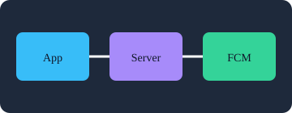

# 로컬 이미지 테스트

이 파일은 **같은 폴더(`test/manual/image_sample`)**의 이미지를 읽는지 확인합니다.
각 항목 아래에 이미지가 보이면 통과, 빨간 깨진 아이콘 + 설명 글자가 보이면 실패입니다.

## 1. 상대 경로 PNG
`` → 가로 그라데이션(빨강→초록 느낌) 이미지가 보여야 함

## 2. ./ 로 시작하는 경로
`` → 위와 같은 이미지

## 3. SVG 파일
`` → App → Server → FCM 파란/보라/초록 상자 3개

## 4. 폴더 이름에 공백, 한글 파일명
`` → 노란/주황 체크무늬

공백을 %20 없이 `<>` 로 감싼 형태도 확인합니다.

## 5. 상위 폴더 경로 (../)
`sub/parent-ref.png` 는 아래 `sub` 안에 있고, 같은 이미지를 `sub/../images/photo.png` 형태로도 불러봅니다.

## 6. 크기 지정 (HTML img) — 참고용
`` 는 마크다운 라이브러리가 HTML을 해석하지 않아 **글자 그대로 보이거나 안 보일 수 있습니다** (현재 미지원, 실패로 보지 않음).

## 7. 링크 안의 이미지 (배지)
이미지를 눌러도 **링크가 열려야** 합니다 (확대되면 안 됨).

## 8. 없는 파일
아래는 일부러 없는 파일입니다. 깨진 아이콘 + 글자 "없는 이미지" 가 나와야 하고 앱이 멈추면 안 됩니다.

## 9. 인라인 data URI (SVG)

→ 빨간 원

## 10. 네트워크 이미지 (인터넷 필요)

## 11. 탭하면 확대
위 1번 이미지를 눌러 확대/닫기가 되는지 확인합니다.

---

### 통과 기준 요약

| 번호 | 기대 결과 |
|------|-----------|
| 1, 2 | 그라데이션 PNG |
| 3 | 파란/보라/초록 SVG 상자 |
| 4 | 체크무늬 PNG 2개 |
| 5 | 하늘색 PNG, 그라데이션 PNG |
| 6 | 참고용 (HTML은 미지원) |
| 7 | 초록 배지, 눌러서 링크가 열림 |
| 8 | 깨진 아이콘 + 글자 |
| 9 | 빨간 원 |
| 10 | 인터넷 연결 시 Flutter 로고 |
